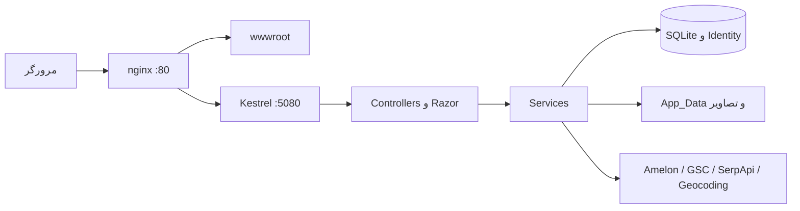

# نقشهٔ فنی Movasseghi Store

تاریخ بررسی: ۲۰۲۶-۱۰-۳۰. مبنای مخزن: `f6d6ab3` از شاخهٔ `main`.
این سند مرجع ادامهٔ توسعه است؛ با تغییر کد باید به‌روز شود.
فهرست‌برداری اولیه ۴۵۳ فایل متنی و حدود ۷۲ هزار خط، بدون وابستگی‌های نصب‌شده،
خروجی‌های .NET و باندل‌های تولیدشده را پوشش داد. این شمارش به معنای بررسی
خط‌به‌خط یا اثبات درستی همهٔ فایل‌ها نیست. مسیرهای اصلی و نقاط حساس زیر بررسی شدند.

## معماری و اجرای درخواست

پروژهٔ فعلی یک monolith با ASP.NET Core MVC/Razor روی .NET 10 است؛ Next.js
تاریخی است. Node برای ساخت TipTap و CSS استفاده می‌شود، نه اجرای وب‌سرور.



- نقطهٔ ورود و DI: `src/MovasseghiShop.Web/Program.cs`.
- داده: `Data/ApplicationDbContext.cs` و `Data/DbInitializer.cs`.
- نمای عمومی: `Views/Shared/_Layout.cshtml`؛ صفحهٔ خانه: `Views/Home/Index.cshtml`.
- پنل مدیریت: `Areas/Admin`، با controllerهای چندگانه در `AdminControllers.cs`.
- پایگاه دادهٔ محلی SQLite است؛ سرور خارجی دیتابیس برای توسعه لازم نیست.
- راه‌اندازی دیتابیس از `EnsureCreated`، اصلاح ستون‌ها/جدول‌ها و seed استفاده می‌کند؛
  نباید آن را معادل migrationهای نسخه‌دار و قابل rollback دانست.
- `DbInitializer` می‌تواند داده را اصلاح کند، محصول وارد کند و تصاویر را محلی کند؛
  اجرای برنامه روی یک دیتابیس ناشناخته عملیاتی صرفاً خواندنی نیست.

## مسیرهای اصلی و مالکیت کد

| بخش | مسیر یا ورودی | پیاده‌سازی اصلی |
| --- | --- | --- |
| خانه | `/`، `/Home/Stories.json` | `HomeController`، `HomeStoryService`، selectorهای محصولات |
| کاتالوگ | `/Catalog`، دسته، نوع، پیشنهاد جستجو | `CatalogController`، `ProductCatalogService` |
| محصول | `/Shop/Product/{slug}` | `ShopController`، `ProductStorefrontResolver`، `ProductImageHelper` |
| سبد | `/Cart`، `Panel/Add/Update/Remove/Csrf` | `CartController`، `CartService`، `CartAnalyticsHelper` |
| تأیید و سفارش | `/Checkout`، `/Order/*` | `CheckoutController`، `OrderService`، `OrderController` |
| پرداخت | `/Payment/Mock` و `Confirm` | `PaymentController`، `IPaymentGateway` |
| حساب | `/Account/*` | `AccountController`، Identity، `IOtpService` |
| محتوا | `/Blog/Post/{slug}`، `/News/Article/{slug}`، `/Page/*` | controllerهای Blog/News/Page و Razor |
| مدیریت کالا و سفارش | `/Admin/Products`، `/Admin/Orders` | `Areas/Admin/Controllers/AdminControllers.cs` |
| سازندهٔ خانه و منو | `/Admin/StudioContent/*` | `StudioContentService` و ViewComponentها |
| مدیریت استوری | `/Admin/StoriesAdmin/*` | `StoriesAdminController`، `HomeStoryService` |
| استودیو SEO و editorial | `/Admin/Studio/*` | `StudioController` و سرویس‌های SEO/Editorial |
| آمار | `/Admin/Reports/*`، `/api/analytics/*` | `AnalyticsTracker`، `AnalyticsReportService` |
| تصاویر | `/media/*`، `/images/*` | `MediaController`، `ImageOptimizerService` |
| خزیدن | `/sitemap.xml`، فایل‌های robots/llms/ai | `SitemapController` و `wwwroot` |

## مدل داده و حالت ماندگار

گروه‌های اصلی `ApplicationDbContext`:

- کالا: `Category`، `Product`، `ProductVariant`، `ProductImage`، `ProductReview`.
- خرید: `Order`، `OrderItem`، `OrderVehicleInfo`، `OrderDeliveryAddress`، `Coupon`، `PurchaseInquiry`.
- هویت: Identity، `ApplicationUser`، `UserAddress`، `OtpCode`.
- محتوا: `BlogPost`، `NewsItem`، `FaqItem`، `CmsPage`، `HomeSection`، `NavItem`، `ContentAtom`.
- استوری: `HomeStory` و `HomeStorySlide`؛ اگر استوری مدیریتی فعال نباشد، سرویس fallback خودکار دارد.
- SEO/Growth: `SeoProfile`، `PillarKeyword`، `RankSnapshot`، `CompetitorSnapshot`،
  `GrowthAction`، `GrowthReport`، `EditorialTopicQueue`، `AuthorityCheckItem`.
- آمار: `PageVisit` و `SiteEvent`.

`data/movasseghi.db.gz` تصویر نمونهٔ کاتالوگ است، نه نسخهٔ زندهٔ production.
فایل DB جاری، `appsettings.Production.json`، داده‌های `App_Data` و تصاویر آپلودی
دارایی ماندگارند و باید در انتشار حفظ و مستقل پشتیبان‌گیری شوند.
Session و صف‌های حافظه‌ای با restart از دست می‌روند؛ snapshot محیط، پردازش زنده را حفظ نمی‌کند.

## قیمت، بسته‌بندی و سفارش

- منبع PDF استخراج‌شده: `App_Data/amelon-prices.json`؛ نگاشت: `amelon-wholesale-map.json`.
- `AmelonPriceSyncService` نگاشت دستی، محاسبه و ساخت واریانت‌های canonical را انجام می‌دهد.
- `WholesalePriceCalculator`: قیمت فله در ورودی ریالِ هر عدد است؛ شیرینگ ریالِ کل بسته.
  خروجی فروشگاه تومان است. تعداد عدد/بسته/کارتن نباید جای یکدیگر استفاده شوند.
- `SellUnitType`: نایلون فله، کارتن فله، بسته شیرینگ و کارتن شیرینگ.
- `ProductVariantAdminService` فرم بسته‌بندی را به واریانت‌ها تبدیل می‌کند.
- `ProductStorefrontResolver` واریانت‌های قابل فروش و حداقل قیمت را انتخاب می‌کند.
- سبد از Session خوانده می‌شود؛ `ms_cart_n` فقط نشانگر شمارش برای UI و تصمیم کش است،
  نه منبع قابل اعتماد قیمت. قیمت در سرور از DB دوباره خوانده می‌شود.
- `WholesaleRules`: حداقل سفارش ۱۰ میلیون تومان؛ تخفیف مبلغی پلکانی ۳ تا ۱۲ درصد؛
  سطح ویژه ۱۸۰ کارتن یا ۷۰۰ میلیون تومان. این‌ها قرارداد تجاری فعلی کدند، نه پیشنهاد تغییر.
- `OrderService` تأیید انسانی، حداقل سفارش، تحویل و کوپن را کنترل می‌کند؛
  مسیر سفارش فعلی فقط پرداخت نقدی هنگام بارگیری را می‌پذیرد.
- قیمت JSON-LD محصول با ضرب تومان در ۱۰ به IRR تبدیل می‌شود؛ هنگام تغییر قیمت این تبدیل حفظ شود.

ممیزی روی DB محلی: ۱۰۰ مقایسه موفق، ۳ اختلاف، ۲۶ کد PDF بدون نگاشت و ۹۰ واریانت
قیمت‌دار روی محصولات خارج از نگاشت ممیزی. سه اختلاف مربوط به
`AM-000406-BC`، `AM-000107-BN` و `AM-000107-BC` است.
بعضی کدهای PDF به یک محصول مشترک می‌رسند؛ اصلاح خودکار این سه قیمت بدون
تأیید نگاشت و منبع معتبر می‌تواند قیمت صحیح را خراب کند. این ممیزی، تست DB سرور نیست.

## قراردادهای صفحهٔ خانه

- `HomeFeaturedProductsSelector` و `HomeSpecialOffersSelector` حداکثر ۸ مورد فعال
  و علامت‌خورده در هر جایگاه می‌دهند؛ تعداد ۸ به موجودبودن داده بستگی دارد.
- استوری‌ها بالای هیرو رندر می‌شوند؛ payload اسلایدها جداگانه از Stories.json می‌آید.
- هیرو SSR است؛ تصویر اول eager و با `fetchpriority=high` و preload است.
- `ProductImageHelper.GetLcpDisplayUrl` فایل LCP موجود را انتخاب می‌کند؛
  `ImageOptimizerService` مشتق‌های تصویری را تولید می‌کند.
- CSS بحرانی inline و باندل کامل `media=print` با فعال‌سازی `onload` است؛
  `noscript` stylesheet fallback دارد.
- `npm run build:critical-home` قواعد بالای صفحه را از باندل اصلی، با حفظ cascade و
  media queryها استخراج و minify می‌کند. خروجی دستی و مستقل از قالب نگهداری نمی‌شود.
- `stories.js` و `home.js` deferred هستند؛ JS سبد/حساب روی تعامل یا idle آماده می‌شود.
  کلیک اول باید پس از آماده‌شدن handlerها دقیقاً یک‌بار اجرا شود.
- فایل‌های `stories-lazy.js` و `site-defer-home.js` در مسیر عادی فعلی خانه مصرف نمی‌شوند؛
  صرف وجودشان، رفتار runtime را ثابت نمی‌کند.

## کش و آمار

سه لایه باید هماهنگ باشند: Output Cache در برنامه، هدرهای HTTP و proxy cache در nginx.

- کاربر واردشده، نشست موجود و سبد غیرخالی نباید HTML شخصی را به کش مشترک بفرستند.
- کوکی تحلیلی `_mv` به‌تنهایی موجب شخصی‌سازی HTML نیست.
- پاسخ دارای `Set-Cookie`، `private` یا `no-store` و پاسخ خطا نباید public شود.
- nginx فقط مسیرهای عمومی صریح را cache می‌کند و هدرهای برنامه را رعایت می‌کند.
- مسیرهای سفارش، صورتحساب، پرداخت، سبد، حساب و API در کش عمومی قرار نمی‌گیرند.
- asset دارای `?v=` کش طولانی immutable دارد؛ asset بدون version کوتاه‌تر cache می‌شود،
  چون تصاویر ممکن است با همان URL بازنویسی شوند.
- صف آمار با سرویس پس‌زمینه در DB تخلیه می‌شود. با تغییر جایگاه Output Cache، اثر
  cache hit بر شمارش بازدید را نیز بررسی کنید؛ صفر بودن خطای صفحه اثبات صحت آمار نیست.

## SEO، AEO، GEO و تولید محتوا

`SeoEngineService` و `SeoUltimateAnalyzer` تحلیل، `SeoAutoFixEngine` اصلاح،
`SeoUltimateWriter`/builderها تولید متن و `SeoMaintenanceService` نگهداری را انجام می‌دهند.
در `Services/ContentPipeline` مسیر SERP → دریافت رقبا → relevance/gap → keyword map →
تولید HTML → quality gate وجود دارد. نام AI در این بخش‌ها به معنی اتصال قطعی به یک LLM نیست؛
writerهای قالبی در خود کد وجود دارند.

Editorial شامل صف موضوعات، keyword sync، زمان‌بندی تهران، پنجرهٔ انتشار، cooldown،
سقف روزانه و quality/publish gate است. اجرای maintenance یا quality sweep صرفاً خواندن نیست.
GSC و SerpApi نیازمند تنظیمات مستقل‌اند؛ رتبهٔ داخلی معادل رتبهٔ واقعی Google نیست.

مرجع الزام‌آور امتیازدهی `.cursor/rules/seo-score-integrity.mdc` است:
`min(weighted average, RankingReadiness, CompetitiveStrength)` همراه با سقف‌های نبود دادهٔ زنده.
نباید برای گرفتن نمره امتیاز، نظر مشتری یا دادهٔ SERP ساختگی تولید یا منتشر شود.
`SeoProductReviewGenerator` پیش‌نویس نظر با نام و تجربهٔ خرید نمونه تولید می‌کند و پنل
امکان تأیید آن را دارد؛ این محتوا نباید به‌عنوان تجربهٔ واقعی مشتری یا rating معتبر منتشر شود.

canonical، robots و sitemap وجود دارند؛ llms.txt/ai.txt تضمین رتبه، citation یا AI readiness نیستند.
با تغییر PublicBaseUrl، سازگاری canonicalهای همهٔ controllerها، sitemap و JSON-LD دوباره کنترل شود.

## ریسک‌های باقی‌مانده و اولویت پیگیری

یافته‌های این بخش از کدند؛ وجود بهره‌برداری در production ادعا نشده است.

1. `MockOtpService` کد ثابت تولید و آن را log می‌کند؛ DI محدود به Development نیست.
   پیش از پذیرش production باید SMS واقعی، expiry/attempt/rate limit و حذف logging کد بررسی شود.
2. `MockPaymentGateway` در DI عمومی ثبت می‌شود و تأیید آن تأیید بانکی نیست.
   `PaymentController.Confirm` باید با provider واقعی، تطابق authority/order/amount و idempotency
   بازطراحی و آزمون شود. «پرداخت نقدی فعلی» به معنی امن‌بودن route mock نیست.
3. seed مدیر با گذرواژهٔ ثابت در initializer شرط محیطی ندارد؛ نیازمند بررسی و جایگزینی امن است.
4. `OrderController.Success` سفارش را با شماره بارگیری می‌کند و کنترل مالکیت/تلفن مشابه
   Details/Invoice ندارد؛ قبل از دسترسی عمومی باید محتوای قابل نمایش و مجوز این مسیر بررسی شود.
5. `quick-republish.sh` خطای pull را نادیده می‌گیرد، smoke آن HTTP غیر۲۰۰ را fail نمی‌کند،
   LCP را hardcode کرده، rollback خودکار ندارد و optimizer را در downtime اجرا می‌کند.
   این اسکریپت در این تغییر بازنویسی نشده و اجرای امن آن روی VPS هنوز تأیید نشده است.
6. نگاشت‌های مبهم قیمت، محدودیت concurrency کوپن و حالت فقط-کارتن شیرینگ در فرم ادمین
   نیازمند تست اختصاصی‌اند؛ بدون تأیید قرارداد کسب‌وکار تغییر نکنند.
7. ImageSharp 3.1.6 چند advisory دارد؛ ارتقای وابستگی باید با تست تصویر و مصرف حافظه انجام شود.
8. کلاینت Amelon در `Program.cs` proxy را خاموش می‌کند؛ با شبکهٔ پراکسی‌محور محیط سازگار نیست.
9. controller و سرویس‌های بسیار بزرگ، ثبت دستی schema و نبود CI فعال، خطر regression را بالا می‌برند.

## تست و وضعیت اعتبارسنجی

محیط آماده‌شده SDK 10.0.403، Node 24 و DB نمونهٔ دارای ۱۰۴ محصول دارد.
دستور تست واقعی، پروژهٔ تست است؛ solution فعلی آن را شامل نمی‌شود:

```bash
. /workspace/.setup/env.sh
dotnet test tests/MovasseghiShop.Web.Tests/MovasseghiShop.Web.Tests.csproj --no-restore \
  -p:DirectoryBuildTargetsPath=/workspace/.setup/cloud.targets -p:UseSharedCompilation=false
node scripts/verify-home-performance.cjs
NGINX_BINARY=/path/to/nginx python scripts/verify-proxy-cache.py
```

تست مرورگر به Playwright و Chromium نصب‌شده نیاز دارد؛ `BASE_URL` و `CHROMIUM_PATH` قابل تنظیم‌اند.
تست nginx از upstream و پورت‌های موقت محلی استفاده می‌کند و nginx سیستم را تغییر نمی‌دهد.
تست‌های HTTP/مرورگر فقط روی دیتابیس نمونه اجرا شده‌اند؛ سفارش یا پرداخت production ایجاد نشده است.
گزارش GTmetrix و IP زنده در این نشست با منع شبکهٔ محیط روبه‌رو شدند؛ تا رفع آن و فراهم‌شدن
اتصال SSH، هیچ ادعای خواندن Waterfall زنده، deploy یا گرفتن نمرهٔ جدید معتبر نیست.
